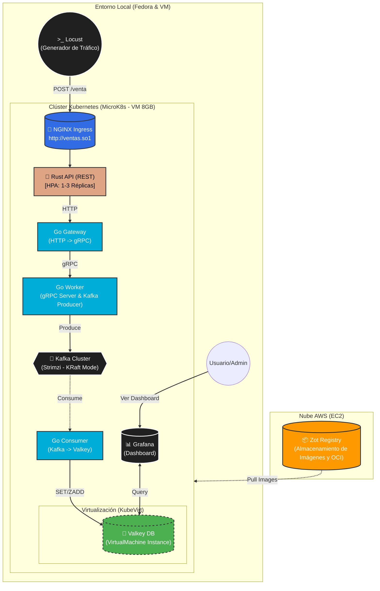

# Informe Técnico: Arquitectura Distribuida en la Nube con Kubernetes
**Curso:** Sistemas Operativos 1

**Proyecto 2: Sistema de Procesamiento de Ventas Black Friday**

## 1. Arquitectura del Sistema

El sistema implementa una arquitectura de microservicios híbrida y distribuida, diseñada para soportar alta concurrencia y procesamiento de datos en tiempo real.

### Diagrama de Componentes


### Flujo de Datos
1.  **Generación de Carga:** **Locust** simula miles de usuarios enviando transacciones de venta.
2.  **Ingreso (Ingress):** Un controlador **NGINX** recibe el tráfico HTTP en el dominio `ventas.so1` y lo enruta al servicio frontend.
3.  **API Frontend (Rust):** Recibe las peticiones REST. Cuenta con **HPA (Horizontal Pod Autoscaling)** para escalar réplicas automáticamente según el uso de CPU.
4.  **Intermediario (Go Gateway):** Recibe la petición HTTP de Rust y la transforma a **gRPC**.
5.  **Procesamiento (Go Worker):** Servidor gRPC que recibe la data y actúa como **Producer** para Kafka.
6.  **Cola de Mensajería (Kafka):** Un clúster de Kafka en modo **KRaft** (sin ZooKeeper) gestionado por **Strimzi**, que desacopla la recepción del almacenamiento.
7.  **Consumo (Go Consumer):** Lee los mensajes de Kafka en tiempo real, calcula estadísticas y las almacena.
8.  **Almacenamiento (Valkey en KubeVirt):** Base de datos en memoria (compatible con Redis) ejecutándose dentro de una **Máquina Virtual (VM)** gestionada por KubeVirt dentro del clúster.
9.  **Visualización (Grafana):** Dashboard conectado a Valkey para monitoreo en tiempo real.
10. **Registro (Zot):** VM externa en AWS EC2 que almacena las imágenes Docker y artefactos OCI.

---

## 2. Documentación de Deployments

### A. `rust-api` (Frontend)
*   **Función:** Punto de entrada HTTP.
*   **Escalabilidad:** Configurado con HPA.
    *   *Min Replicas:* 1
    *   *Max Replicas:* 3
    *   *Trigger:* CPU > 30%
*   **Comunicación:** Envía HTTP POST al servicio `go-gateway`.

### B. `go-gateway` (Intermediario)
*   **Función:** Puente de traducción de protocolos.
*   **Patrón:** API Gateway / Adapter.
*   **Comunicación:** Recibe HTTP, envía gRPC al `go-worker`.

### C. `go-worker` (Procesador gRPC)
*   **Función:** Lógica de negocio y publicación de eventos.
*   **Características:**
    *   Servidor gRPC de alto rendimiento.
    *   Cliente Productor de Kafka (Librería Sarama).
*   **Réplicas:** Desplegado con 2 réplicas para demostrar balanceo de carga gRPC.

### D. `go-consumer` (Consumidor)
*   **Función:** Persistencia y Analítica.
*   **Lógica:** Consume mensajes del tópico `ventas-topic`. Calcula estadísticas (Top productos, precios máximos) y las guarda en estructuras de datos de Redis (Hashes, ZSets).

### E. `kafka-cluster` (Infraestructura)
*   **Tecnología:** Strimzi Operator.
*   **Modo:** KRaft (Kafka Raft Metadata), eliminando la dependencia de ZooKeeper para mayor ligereza.
*   **Nodos:** Configurado con NodePools.

### F. `valkey-vm` (Base de Datos)
*   **Tecnología:** KubeVirt.
*   **Tipo:** `VirtualMachine` (no Pod).
*   **OS:** Fedora/Alpine (Cloud-Init configurado para instalar Redis/Valkey al inicio).
*   **Justificación:** Cumplimiento del requisito de virtualización dentro de contenedores.

---

## 3. Instrucciones de Despliegue y Pruebas

### Prerrequisitos
*   Clúster Kubernetes (MicroK8s) con addons: `dns`, `ingress`, `kubevirt`, `storage`, `metrics-server`.
*   Instancia Zot (Registry) accesible.

### Paso 1: Infraestructura Base
```bash
# 1. Aplicar Kafka (Esperar a que esté Ready)
kubectl apply -f k8s/kafka-cluster.yaml

# 2. Aplicar VM de Base de Datos
kubectl apply -f k8s/valkey-vm.yaml
# (Esperar a que la VM esté en estado Running)

# 3. Aplicar Servicio de Base de Datos
kubectl apply -f k8s/valkey.yaml
```

### Paso 2: Desplegar Aplicaciones
```bash
# Desplegar Rust, Gateway, Worker y Consumer
kubectl apply -f k8s/apps/
```

### Paso 3: Configuración de Red Local
Editar `/etc/hosts` para resolver el Ingress:
```bash
192.168.122.229 ventas.so1  # IP del Nodo Kubernetes
```

### Paso 4: Pruebas con Locust
1.  Ejecutar `locust` en la máquina local.
2.  Acceder a `http://localhost:8089`.
3.  **Host:** `http://ventas.so1`
4.  Iniciar prueba y monitorear Grafana.

---

## 4. Conclusiones y Comparativas

### Rendimiento: API REST vs gRPC
Durante el desarrollo se observó que la comunicación interna entre microservicios (Go-to-Go) utilizando **gRPC** (Protocol Buffers) es significativamente más eficiente que REST.
*   **REST (Rust -> Go):** Payload JSON legible pero pesado (texto). Requiere parsing constante.
*   **gRPC (Go -> Go):** Payload binario, fuertemente tipado. Menor latencia y menor uso de ancho de banda interno en el clúster.

### Kafka como Backbone
La implementación de Kafka permitió desacoplar la recepción de ventas del procesamiento. Incluso bajo carga pesada de Locust, la API de Rust nunca se bloqueó esperando la base de datos, ya que el **Worker** solo confirmaba la recepción en Kafka (escritura secuencial rápida) y el **Consumer** procesaba a su ritmo. Esto garantiza alta disponibilidad.

### Valkey en KubeVirt vs Contenedor
Ejecutar Valkey en una VM (KubeVirt) introduce una capa adicional de abstracción (QEMU sobre Containerd).
*   **Ventaja:** Aislamiento total del kernel, útil para bases de datos que requieren configuraciones de SO específicas o persistencia robusta.
*   **Desventaja:** Tiempo de arranque lento (minutos vs segundos de un contenedor) y mayor consumo de RAM (overhead del SO invitado). Para bases de datos en memoria de alto rendimiento, un contenedor nativo suele ser más eficiente, pero KubeVirt ofrece mayor flexibilidad de infraestructura.

### HPA en Rust API
El uso de HPA permitió que la API de Rust escalara automáticamente bajo carga, manteniendo tiempos de respuesta aceptables. Las répilicas adicionales se activaron cuando el CPU superó el umbral del 30%, demostrando la efectividad del escalado automático en Kubernetes. Esto ayudó a manejar picos de tráfico durante las pruebas de Locust sin degradación significativa del rendimiento. Al activarse las 3 réplicas, el porcentaje de CPU se distribuyó, manteniendo la latencia baja, sin sobrepasar los límites establecidos (CPU > 30%).

---

## 5. Proceso de Desarrollo y Retos Resueltos

El proyecto se desarrolló siguiendo una metodología iterativa, comenzando con una arquitectura en la nube (AWS) y migrando hacia una solución híbrida robusta.

### Reto 1: Limitaciones de Hardware en Nube (AWS)
*   **Problema:** Al intentar desplegar la pila completa (Kafka + KubeVirt + Apps) en una instancia `t3.medium` (4GB RAM) en AWS, el sistema sufría de agotamiento de recursos (OOM Kills) y los tiempos de espera (timeouts) causaban fallos en cadena.
*   **Solución:** Se migró el Clúster de Kubernetes a una **Máquina Virtual Local con 8GB de RAM** y virtualización anidada habilitada. Se mantuvo el Registry (Zot) en AWS para conservar la arquitectura híbrida y cumplir el requisito de nube.

### Reto 2: Redes en AWS y MicroK8s (MTU)
*   **Problema:** Durante las pruebas en AWS, la comunicación entre pods fallaba aleatoriamente o daba timeouts.
*   **Causa:** La encapsulación VXLAN de Kubernetes generaba paquetes más grandes que el MTU soportado por la red de AWS, causando descarte de paquetes.
*   **Solución:** Se diagnosticó usando `telnet` entre pods y se solucionó ajustando el MTU de Calico CNI a **1350 bytes** y desactivando el *checksum offloading* en la interfaz de red.

### Reto 3: Compatibilidad de Strimzi Kafka
*   **Problema:** El Operador de Strimzi instalado era demasiado reciente para la configuración YAML inicial, rechazando versiones antiguas de Kafka y configuraciones de Zookeeper.
*   **Solución:** Se actualizó la definición del clúster para utilizar el modo **KRaft** (sin Zookeeper) y `KafkaNodePools`, alineándose con las prácticas modernas de Kafka en Kubernetes.

### Reto 4: Registro Inseguro (HTTP)
*   **Problema:** Kubernetes fallaba al descargar imágenes (`ErrImagePull`) desde Zot en AWS porque este usaba HTTP sin certificado.
*   **Solución:** Se configuró el archivo `hosts.toml` en MicroK8s y el `daemon.json` en Docker local para permitir explícitamente el registro inseguro (`insecure-registries`).